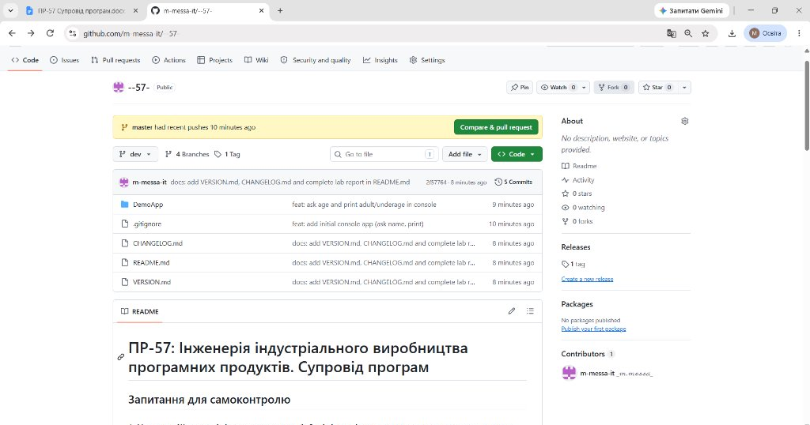
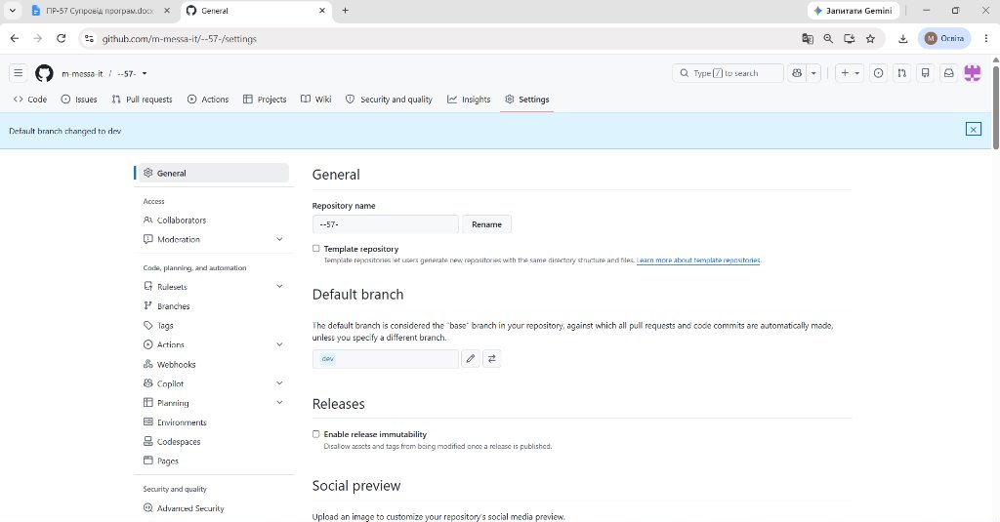
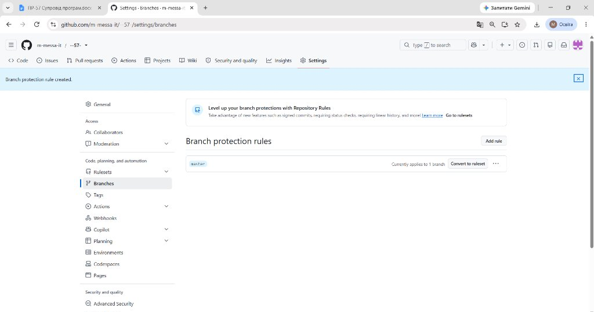

# Практична робота

**Тема:** Інженерія індустріального виробництва програмних продуктів. Супровід програм  
**Мета:** Відпрацювати процес супроводу ПЗ у Git, навчитись працювати з гілками, ознайомитись з процесом випуску нових версій програмного продукту.

---

## Скріншоти виконання роботи

### 1. Головна сторінка репозиторію (гілка `dev` за замовчуванням, структура файлів, коміти та релізний тег v1.0)


### 2. Налаштування основної гілки за замовчуванням (`Default branch: dev`)


### 3. Налаштування правила захисту для релізної гілки `master` (Branch protection rule)


---

## Відповіді на запитання

### 1. Чому у цій моделі dev задається як default branch, а master використовується лише для релізів? Які переваги й ризики такого підходу?
- **Причина призначення `dev` як default branch:** Під час щоденної розробки всі нові завдання, виправлення та запити на злиття (Pull Requests) мають автоматично спрямовуватися в робочу гілку розробки, а не в релізну. Встановлення `dev` за замовчуванням унеможливлює випадкові коміти та злиття сирого коду безпосередньо в стабільну релізну гілку `master`. Гілка `master` залишається виключно для готових, повністю відтестованих версій продукту (production-ready).
- **Переваги:**
  - Надійний захист стабільного релізного коду від випадкових незавершених або неперевірених змін.
  - Чітке розмежування середовищ розробки (`dev`) та стабільного релізу (`master`).
  - Прозора історія релізів у `master` (кожен коміт — це офіційний випуск або тегована версія).
  - Спрощення командної роботи: нові розробники за замовчуванням створюють свої робочі гілки від `dev`.
- **Ризики:**
  - Ризик розсинхронізації: якщо термінові виправлення (hotfix) вносяться в `master` або дрібні правки додаються в релізні гілки, їх обов'язково треба вручну влити назад у `dev`, інакше ці зміни можуть загубитися.
  - Потреба в суворій дисципліні злиття та проходженні обов'язкових перевірок під час виконання Pull Request.

---

### 2. У яких випадках варто відгалужувати release/* гілку? Що саме робиться у ній до моменту релізу?
- **Коли відгалужувати:** Гілку `release/*` (наприклад, `release/1.1`) створюють тоді, коли запланований обсяг функцій для наступної версії повністю реалізовано в гілці `dev` і настав етап «заморозки коду» (feature freeze). 
- **Що саме робиться в гілці до релізу:**
  - Виправлення дрібних помилок і багів, виявлених на етапі фінального тестування (при цьому нові функції суворо заборонено додавати).
  - Оновлення документації проєкту (`README.md`, `CHANGELOG.md`, інструкції користувача).
  - Фіксація номера версії у файлах конфігурації та версіонування (`VERSION.md`, `.csproj` тощо).
  - Проведення регресійного та приймального тестування для гарантії стабільності складання перед злиттям у `master`.
  - Завдяки винесенню цієї активності в окрему гілку основна команда може продовжувати розробку нових функцій у `dev` для наступних версій без затримок.

---

### 3. Чим відрізняється тег від гілки? Наведіть приклади сценаріїв використання кожного.
- **Гілка (branch):** Це рухомий (динамічний) вказівник на останній коміт певної лінії розробки. При додаванні нового коміту вказівник гілки автоматично переміщується на цей новий коміт.
  - *Сценарії використання:* щоденна робота над завданнями (`dev`), ізольована розробка нових функцій (`feature/user-auth`), стабілізація перед релізом (`release/1.1`), термінові виправлення критичних багів (`hotfix/security-fix`).
- **Тег (tag):** Це статична, фіксована мітка на конкретний коміт в історії, яка більше ніколи не змінює свого положення та зберігає точний зліпок стану коду на певний момент часу.
  - *Сценарії використання:* маркування офіційних релізів продукту (`v1.0`, `v1.1.0`), збереження контрольних точок для розгортання в production середовищі, прив'язка версій бібліотек чи релізів на GitHub для завантаження користувачами.

---

### 4. Поясніть правила семантичного версіонування: коли збільшується patch/minor/major?
Семантичне версіонування використовує формат `MAJOR.MINOR.PATCH` (наприклад, `1.1.0`):
- **PATCH (виправлення):** збільшується при внесенні дрібних виправлень помилок (bug fixes) зі збереженням повної зворотної сумісності. Публічний інтерфейс та функціональність програми залишаються незмінними.
- **MINOR (нова функціональність):** збільшується при додаванні нової функціональності, яка не порушує зворотної сумісності (наприклад, додано запит віку та перевірку повноліття в застосунку `DemoApp` — версія оновлюється з `1.0.0` до `1.1.0`). Старий функціонал продовжує коректно працювати.
- **MAJOR (несумісні зміни):** збільшується при внесенні критичних змін (breaking changes), що порушують зворотну сумісність. Користувачам або зовнішнім модулям необхідно адаптувати свій код, щоб працювати з новою версією.

---

### 5. Як переконатися, що dev містить усі зміни з release/1.1 перед закриттям релізу? Які git команди допоможуть це перевірити?
Щоб переконатися, що всі фінальні виправлення, оновлення документації чи номерів версій, внесені в `release/1.1`, потрапили назад в `dev`, використовують наступні команди:
- `git log dev..release/1.1` — показує список комітів, які є в гілці `release/1.1`, але ще не влиті в `dev`. Якщо вивід порожній, це означає, що всі коміти вже присутні в `dev`.
- `git diff dev..release/1.1` — показує різницю у вмісті файлів між двома гілками. Якщо різниці немає, стан коду синхронізовано.
- `git branch --merged dev` — перевіряє, чи гілка `release/1.1` вважається повністю злитою з поточною гілкою `dev`.
- Якщо в `release/1.1` вносилися додаткові зміни, виконують злиття назад у робочу гілку:
  ```bash
  git checkout dev
  git merge release/1.1
  ```
  Це гарантує збереження всіх правок і виключає втрату доробок у майбутніх релізах.

---

## Висновок
Під час виконання практичної роботи було відпрацьовано повний життєвий цикл супроводу програмного забезпечення з використанням системи контролю версій Git. Створено та налаштовано базову структуру гілок репозиторію: робочу гілку `dev`, релізну `master` та підготовчу `release/1.1`. Було розроблено консольний застосунок `DemoApp` версій 1.0 та 1.1, налаштовано файл `.gitignore` для фільтрації системних артефактів збірки, відпрацьовано механізм злиття змін через Pull Request та тегування випусків (`v1.0`). Ознайомлено з принципами семантичного версіонування та ведення журналів змін за допомогою файлів `VERSION.md` і `CHANGELOG.md`.
